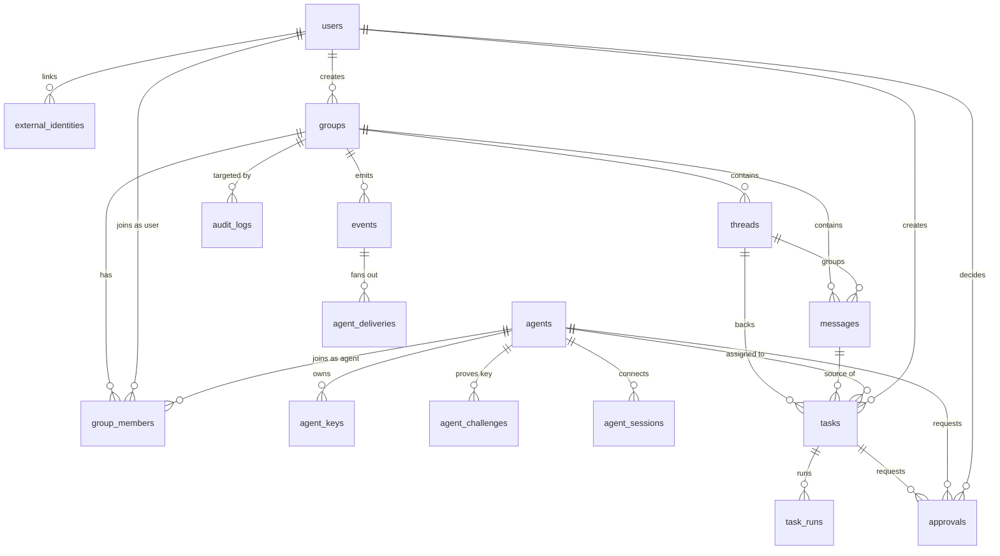

# Room Core 与认证数据库设计（M2/M3）

本文档记录 M2「Room Core」与 M3 认证相关表的 ERD、Drizzle schema、迁移、索引与关键查询计划。实现以
`packages/database/src/schema.ts` 为准，迁移在 `packages/database/drizzle/`。

## 1. 运行时约定

| 项目     | 约定                                                                                              |
| -------- | ------------------------------------------------------------------------------------------------- |
| 引擎     | SQLite（`better-sqlite3` 13.x），Drizzle SQLite dialect                                           |
| 日志模式 | `journal_mode = WAL`                                                                              |
| 约束     | `foreign_keys = ON`                                                                               |
| 写锁等待 | `busy_timeout = 5000`                                                                             |
| 持久性   | `synchronous = FULL`                                                                              |
| 写入模型 | 单进程单写者；进程级锁库 `room.db.lockdb`（`BEGIN IMMEDIATE`）                                    |
| 事务     | 业务写入 + `events` + `agent_deliveries` + `audit_logs` 同一事务；**事务内禁止 AI/网络/用户等待** |
| ID       | `前缀_UUIDv4去掉横线`，如 `usr_9f2c…`；不可猜测、URL 安全（`@room/protocol` 的 `newId`）          |
| 时间     | DB 存 UTC 毫秒整数；API 层用 ISO 8601（`toIso`）                                                  |
| 布尔     | SQLite `0/1`（Drizzle `mode: "boolean"`）                                                         |
| JSON     | `payload` / `metadata` / `capabilities` 先经 zod 校验再序列化                                     |
| 删除     | 消息软删除（`deleted_at`）；结构性删除靠外键 `ON DELETE CASCADE`                                  |

## 2. ERD



说明：

- `group_members` 是**多态成员表**（`member_type` + `member_id`），因此 `member_id` 没有单一外键；
  成员存在性由服务层 `assertKnownMember` 校验，唯一索引保证同一群体内不重复。
- `threads.source_message_id` 与 `messages.thread_id` 互相引用会形成环，SQLite 迁移无法建表，
  所以 `source_message_id` 不建外键；服务层校验消息存在且同群。
- `events` / `audit_logs` 不挂 `groups` 外键：它们是审计事实，群体删除后仍需保留。
- `tasks.source_message_id` 在删除源消息时置空（`ON DELETE SET NULL`），任务本身保留。

## 3. 表

| 表                     | 作用                             | 关键列                                                                             |
| ---------------------- | -------------------------------- | ---------------------------------------------------------------------------------- |
| `system_meta`          | 运行时元数据（M1 保留）          | `key` PK                                                                           |
| `users`                | 平台用户与全局角色               | `role`（owner/admin/member/readonly）、`status`                                    |
| `external_identities`  | Cloudflare Access 等外部身份映射 | `(issuer, subject)` 唯一                                                           |
| `groups`               | 群组 + AI 参与策略               | `participation_mode`、`allow_agent_messages`、`max_hops`、`max_replies_per_root`   |
| `group_members`        | 群体成员（用户/Agent）           | `(group_id, member_type, member_id)` 唯一、`member_role`                           |
| `agents`               | Agent 注册表                     | `runtime`、`status`、`capabilities`(JSON)                                          |
| `agent_keys`           | Agent 公钥（Ed25519）            | `fingerprint` 唯一、`status`                                                       |
| `agent_challenges`     | 一次性 Challenge（M3）           | `nonce` 唯一、`used_at`（重放保护）、`expires_at`                                  |
| `agent_sessions`       | Agent WSS 会话（M3）             | `token_hash` 唯一、`last_seen_at`、`closed_at`、`close_reason`                     |
| `agent_socket_tickets` | WSS 一次性升级票据（M3）         | `ticket_hash` 唯一、`used_at`、`expires_at`、`session_id`                          |
| `threads`              | 由源消息派生的讨论串             | `source_message_id`、`status`                                                      |
| `messages`             | 群消息                           | `seq`（群内单调）、`client_message_id`（幂等）、`root_message_id`、`hop`           |
| `tasks`                | 任务                             | `status`、`assigned_agent_id`、`thread_id`、`source_message_id`、`result`、`error` |
| `task_runs`            | 任务执行轮次                     | `status`、`summary`、`started_at`/`finished_at`、`progress_percent`                |
| `approvals`            | Task 审批请求与决策              | `status`、`decided_by_user_id`、`decided_at`、`reason`、`expires_at`               |
| `events`               | 事务性 Outbox 事件               | `seq` 自增、`id` 唯一、`payload`(JSON)                                             |
| `agent_deliveries`     | 每个 Agent 的投递队列            | `(agent_id, event_id)` 唯一、`status`                                              |
| `audit_logs`           | 审计                             | `actor_type/actor_id`、`action`、`target_type/target_id`                           |

## 4. 索引（45 个显式索引）

| 表                     | 索引                                                                                                                                                             | 用途                                                            |
| ---------------------- | ---------------------------------------------------------------------------------------------------------------------------------------------------------------- | --------------------------------------------------------------- |
| `users`                | `users_role_idx`、`users_status_idx`、`users_email_lower_uq`                                                                                                     | 管理员筛选、邮箱唯一映射                                        |
| `external_identities`  | `external_identities_issuer_subject_uq`、`external_identities_user_idx`                                                                                          | 登录映射、按用户查                                              |
| `groups`               | `groups_status_idx`、`groups_created_by_idx`                                                                                                                     | 归档筛选、创建者                                                |
| `group_members`        | `group_members_member_uq`、`group_members_lookup_idx`、`group_members_group_idx`                                                                                 | 权限判定、反查用户/Agent 所在群                                 |
| `agents`               | `agents_status_idx`                                                                                                                                              | 在线/离线                                                       |
| `agent_keys`           | `agent_keys_fingerprint_uq`、`agent_keys_agent_idx`                                                                                                              | 公钥查找、某 Agent 的 key                                       |
| `agent_challenges`     | `agent_challenges_nonce_uq`、`agent_challenges_expiry_idx`                                                                                                       | 一次性消费、过期清理                                            |
| `agent_sessions`       | `agent_sessions_token_uq`、`agent_sessions_agent_idx`、`agent_sessions_expiry_idx`                                                                               | token 校验、在线租约、过期清扫                                  |
| `agent_socket_tickets` | `agent_socket_tickets_hash_uq`、`agent_socket_tickets_expiry_idx`、`agent_socket_tickets_session_idx`                                                            | 票据校验、过期清理、按会话查                                    |
| `threads`              | `threads_group_idx`、`threads_source_message_idx`                                                                                                                | 群内时间线、源消息 → Thread                                     |
| `messages`             | `messages_group_seq_uq`、`messages_group_client_uq`、`messages_thread_seq_idx`、`messages_group_created_idx`、`messages_root_idx`、`messages_sender_created_idx` | 分页、幂等、Thread 时间线、按时间、每 root 回复计数、每分钟限流 |
| `tasks`                | `tasks_group_idx`、`tasks_status_idx`、`tasks_thread_idx`、`tasks_assignee_idx`                                                                                  | 群内任务分页、状态、Thread、Agent 队列                          |
| `task_runs`            | `task_runs_task_idx`                                                                                                                                             | 任务执行历史                                                    |
| `events`               | `events_group_seq_idx`、`events_type_created_idx`、`events_id_unique`                                                                                            | 群内增量、类型检索、按事件 id                                   |
| `agent_deliveries`     | `agent_deliveries_event_uq`、`agent_deliveries_pending_idx`、`agent_deliveries_lease_idx`                                                                        | 去重、待投递队列、租约到期重投                                  |
| `approvals`            | `approvals_task_idx`、`approvals_status_idx`                                                                                                                     | 任务审批列表、待审批筛选                                        |
| `audit_logs`           | `audit_logs_created_idx`、`audit_logs_actor_idx`                                                                                                                 | 时间线、按操作者                                                |

`agent_challenges` 的 `used_at` 以 `UPDATE ... WHERE used_at IS NULL` 原子消费；`agent_sessions` 只存 token 的 SHA-256。

`tasks_group_idx (group_id, created_at, id)` 与 `agent_deliveries_pending_idx
(agent_id, status, created_at)` 把排序键并入索引，避免 keyset 分页时出现临时 B-tree。

M4 新增 `messages_root_idx (root_message_id, created_at)` 与
`messages_sender_created_idx (sender_type, sender_id, created_at)`，分别支撑每个 root
的 Agent 回复预算计数与单 Agent 每分钟限流；两者都在 `postMessage` 事务内查询。

## 5. 关键查询计划

由 `node packages/database/scripts/query-plan.mjs` 在全新迁移库上生成：

```text
messages pagination: SEARCH messages USING INDEX messages_group_seq_uq (group_id=? AND seq>?)
membership lookup: SEARCH group_members USING INDEX group_members_member_uq (group_id=? AND member_type=? AND member_id=?)
group member list: SEARCH group_members USING INDEX group_members_group_idx (group_id=?)
tasks by group: SEARCH tasks USING INDEX tasks_group_idx (group_id=?)
pending deliveries: SEARCH agent_deliveries USING INDEX agent_deliveries_pending_idx (agent_id=? AND status=?)
events by group: SEARCH events USING INDEX events_group_seq_idx (group_id=? AND seq>?)
message idempotency: SEARCH messages USING INDEX messages_group_client_uq (group_id=? AND client_message_id=?)
explicit indexes: 45
```

消息分页使用 `WHERE group_id = ? AND seq > ? ORDER BY seq LIMIT 50`，命中
`(group_id, seq)` 唯一索引，没有全表扫描；测试 `apps/server/test/room.test.ts` 对此有断言。

## 6. 事务边界（服务层）

| 操作                         | 同一事务内写入                                                                                                |
| ---------------------------- | ------------------------------------------------------------------------------------------------------------- |
| `postMessage`                | `messages` + `events(message.created)` + `agent_deliveries`                                                   |
| `createGroup`                | `groups` + 群主 `group_members` + `events` + `audit_logs`                                                     |
| `addMember` / `removeMember` | `group_members` + `events` + `audit_logs`                                                                     |
| `createThread`               | `threads` + `events` + `audit_logs`                                                                           |
| `createTaskFromMessage`      | `threads` + `tasks` + `events(thread.created/task.created/task.assigned)` + `agent_deliveries` + `audit_logs` |
| `completeTask`               | `task_runs` + `tasks` + 汇总 `messages` + `events` + `agent_deliveries` + `audit_logs`                        |

所有函数都在 `ctx.db.transaction(...)` 内完成上述写入；zod 校验、权限判断失败时整个事务回滚。
事务内没有 `fetch`、模型调用或等待用户输入。

### 6.1 投递状态机与请求幂等

`agent_deliveries.status`：

```text
pending ──deliver──▶ delivered ──ack──▶ acked
   │                     │
   │                     └──requeue──▶ pending   （ack 超时后重投）
   └──────────fail───────┴──────────▶ failed
```

- 非法转换抛 `ConflictError`；`acked` 再次 `ack`、`failed` 再次 `fail` 幂等。
- `listPendingDeliveries` 只取 `pending`；`listOutstandingDeliveries` 默认取 `pending + 租约已过期的 delivered`，连接/重连时用 `includeUnacked` 立即补发所有已送达未 ack 的投递，避免“已送达但断线未 ack”的投递永久消失。
- 投递租约：`DELIVERY_LEASE_MS = 30_000`；已送达未 ack 的投递在租约到期后以同一 `deliveryId` 重投并 `attempts + 1`，不会创建新的 Message/Event。超过 `MAX_DELIVERY_ATTEMPTS = 10` 时连接循环将其置为 `failed`（诊断状态），离开可投递窗口，长期未 ack 不会阻塞新投递。
- 重连仍会补发未完成投递；`ackDelivery` 校验 Agent 归属，`failed` 后不能再 ack。
- `tasks(group_id, idempotency_key)` 唯一索引把 HTTP 重试折叠成同一个 Task；`createTaskFromMessage` 命中已有 key 时直接返回原 Task 与 Thread。
- Task 状态只由服务层状态机（`TASK_TRANSITIONS`）推进：Agent 通过 start/progress/pause?（pause 属管理员）/complete 或审批请求改变状态；REST 与 Plugin 不能直接写 `tasks.status`。
- 审批决策与 Task 状态在**同一事务**提交：approve 把 Task 从 `waiting_approval` 拉回 `running`；reject/expire 把 Task/Run 置 `failed`、Thread 置 `failed`，并在父群写一条 system 摘要消息（`client_message_id = task-summary:<taskId>`，`thread_id = null`，正文含 `Thread: <threadId>`），同时写 `task.approval_decided` + `task.failed` 事件与审计。
- 完成摘要同样在事务内写回父群；Thread 消息（`messages.thread_id` 非空）不进入 Group stream（`listMessages` 过滤）。
- `linkExternalIdentity` 的 `external_identities`、`events(identity.linked)`、`audit_logs` 在同一事务提交。
- `agent_sessions` 的 TTL 对活跃连接同样生效；`agent_socket_tickets` 以 `UPDATE ... WHERE used_at IS NULL AND expires_at > ?` 原子消费，只存票据的 SHA-256。
- `users_email_lower_uq` 保证邮箱大小写归一后唯一；迁移前 `assertNoDuplicateUserEmails` 会让含重复邮箱的旧库明确失败。

## 7. 已知偏差（当前实现 vs 目标设计）

- `eventPayloadSchema` 仍是通用 `z.record`，尚未按事件类型逐一定义 payload schema（M3 起随 Agent SDK 收紧）。
- 状态枚举字段没有数据库 `CHECK` 约束，靠 zod 与服务层状态机保证；迁移中不手写 CHECK，避免 Drizzle snapshot 漂移。
- `group_members.member_id` 是多态列、`threads.source_message_id` 因循环依赖无硬外键，均由服务层校验。
- Task 状态机在 M5 实现 `queued/assigned/running/waiting_approval/paused/succeeded/failed/cancelled`；非法转换返回 409。
- Approval 超时（`expiresAt` 已过）由调用方 `expireApproval` 显式推进为 `expired` 并 fail Task，没有后台定时器扫过期审批；审批的唯一通知渠道是 `task.approval_decided` 事件（durable delivery）。
- Agent 发起的 `request_task`（自主创建 Task）尚未实现，属 M5 之后的 M6/M7 Plugin 能力。
- 长连接投递与在线租约已在 M3 实现；M2 只提供状态机与恢复查询。
- M4 起 Agent 发言与参与规则在 `postMessage` 事务内原子执行（allowAgentMessages / hop / maxRepliesPerRoot / maxAgentMessagesPerMinute）；消息只投递给在线 Agent。

## 8. 常用命令

```bash
pnpm --filter @room/database db:generate   # schema.ts -> drizzle/000N_*.sql
pnpm --filter @room/database db:init       # 打开数据库、应用迁移、打印 pragmas
node packages/database/scripts/query-plan.mjs  # 打印上面的查询计划
```
